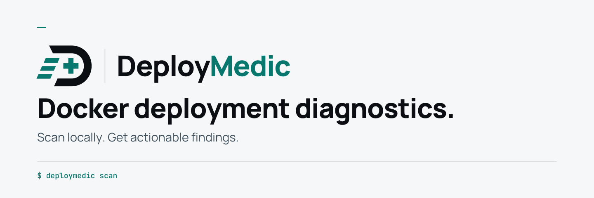
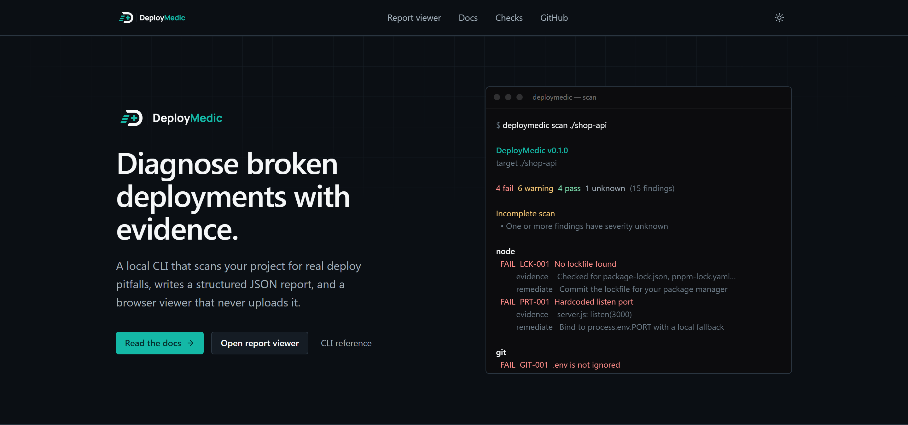
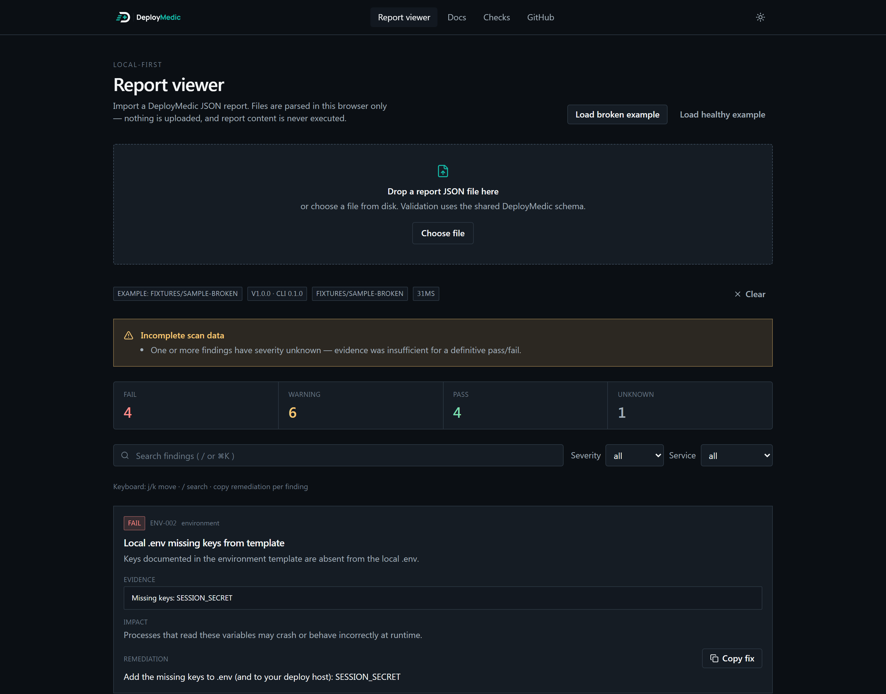
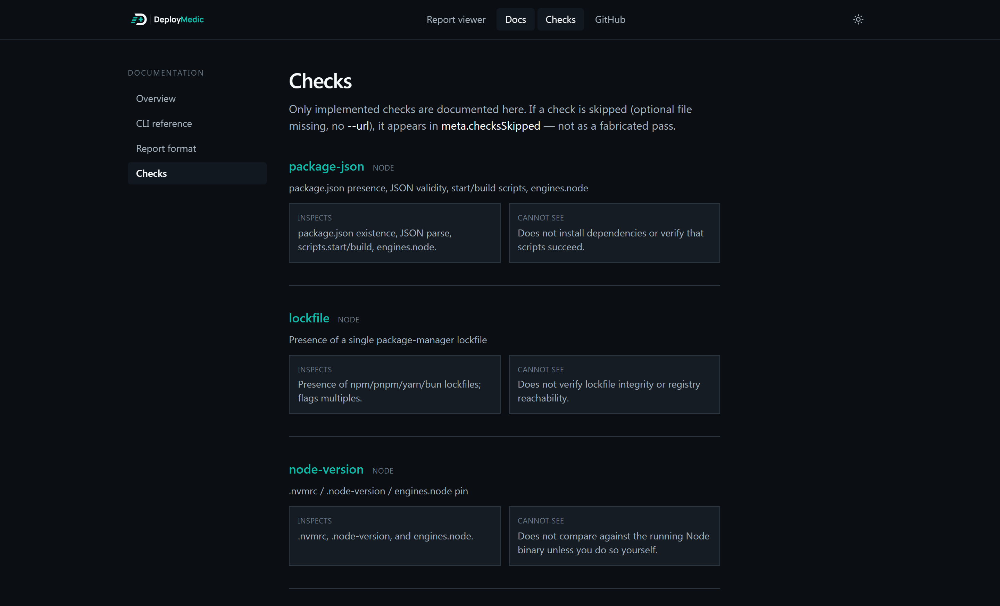

# DeployMedic

<picture>
  <source media="(prefers-color-scheme: dark)" srcset="assets/brand/readme-banner-dark.svg">
  
</picture>

Evidence-first deployment diagnostics.

Scan a project locally, emit a structured JSON report, and review findings in a browser viewer that **never uploads** your data.

**Maintainer:** [NullEx17](https://github.com/NullEx17) · [nullex17.me](https://nullex17.me/)  
**Repository:** [github.com/NullEx17/DeployMedic](https://github.com/NullEx17/DeployMedic)

## Screenshots

| Landing | Report viewer | Docs |
| --- | --- | --- |
|  |  |  |

## Packages

| Path | Name | Role |
| --- | --- | --- |
| `packages/core` | `@deploymedic/core` | Report schema + validation |
| `packages/cli` | `@deploymedic/cli` | `deploymedic` CLI |
| `apps/web` | `@deploymedic/web` | Product site, docs, report viewer |
| `fixtures/` | — | Sample projects for real scans |

## Requirements

- Node.js 20+

## Setup

```bash
git clone https://github.com/NullEx17/DeployMedic.git
cd DeployMedic
npm install
npm run build:core
npm run build:cli
```

## CLI

```bash
# Scan the current directory
node packages/cli/dist/bin.js scan .

# Scan the broken fixture and save JSON
node packages/cli/dist/bin.js scan fixtures/sample-broken --output fixtures/broken-report.json

# Human-readable reprint
node packages/cli/dist/bin.js report fixtures/broken-report.json

# List checks
node packages/cli/dist/bin.js checks
```

Workspace helper: `npm run deploymedic -- scan .`

### Flags

- `--json` — emit JSON to stdout
- `--output <file>` — write JSON report to disk
- `--url <url>` — optional HTTP probe
- `--only <ids>` — comma-separated check ids
- `--color auto|always|never`

Respects `NO_COLOR` and non-TTY stdout. Exit `1` when any finding has severity `fail`.

## Website & viewer

```bash
npm run dev
```

- `/` — product landing
- `/viewer` — local JSON import (drag-and-drop / file picker)
- `/docs` — documentation

## Design

See [DESIGN.md](./DESIGN.md) for principles, information architecture, and visual tokens. Brand assets live in [`assets/brand/`](./assets/brand/).

## Contributing & security

- [CONTRIBUTING.md](./CONTRIBUTING.md) — local workflow and expectations
- [SECURITY.md](./SECURITY.md) — vulnerability reporting and trust boundaries
- [AUDIT.md](./AUDIT.md) — pre-release security/product audit notes

## Verify publishable packages locally

```bash
npm run verify-pack
```

This runs `npm pack --dry-run` for `@deploymedic/core` and `@deploymedic/cli`, then installs the generated tarballs into a temporary directory and executes the CLI. It does **not** publish to npm.

## License

MIT
